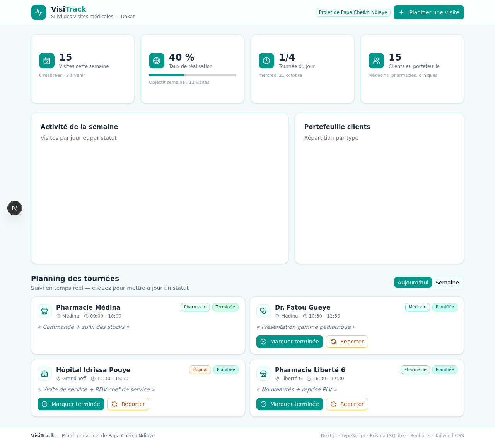
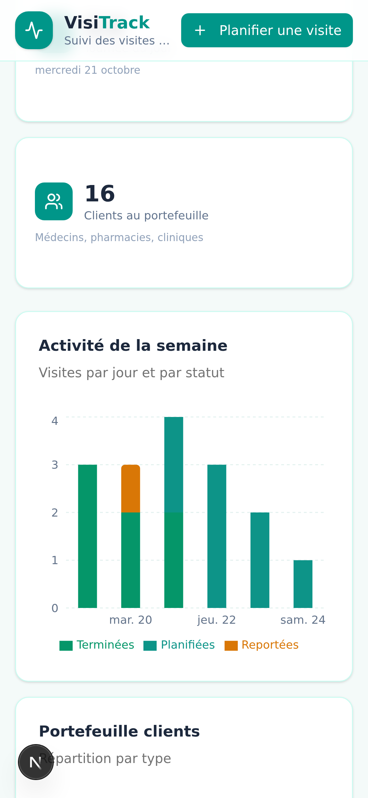

<div align="center">

# 🩺 VisiTrack

**Application web de planification et de suivi des tournées de visiteur médical**

*Next.js 16 · TypeScript · Prisma · Recharts · Tailwind CSS*

[](https://nextjs.org)
[](https://www.typescriptlang.org)
[](https://www.prisma.io)
[](https://tailwindcss.com)

</div>

---

## 📋 Aperçu

VisiTrack est l'outil que j'aurais aimé avoir lors de mes premières tournées : un tableau de bord
qui planifie les visites (médecins, pharmacies, cliniques, hôpitaux), suit leur avancement en
temps réel et mesure la performance de la semaine face à l'objectif fixé.

Développé comme **projet personnel de démonstration** dans le cadre de ma reconversion vers la
visite médicale, il illustre ma capacité à comprendre les besoins du terrain — planification,
statuts, reporting — et à les traduire en solution logicielle concrète.

| Bureau | Mobile |
| --- | --- |
|  |  |

## ✨ Fonctionnalités

- **Tableau de bord temps réel** — 4 indicateurs clés : visites de la semaine, taux de
  réalisation vs objectif (12 visites), tournée du jour, portefeuille clients.
- **Graphiques interactifs** — activité hebdomadaire par jour et par statut (barres empilées),
  répartition du portefeuille par type de client (anneau).
- **Gestion complète des visites (CRUD)** — planifier une visite (client, type, quartier, créneau,
  objectif), marquer *Terminée* ou *Reportée*, suppression.
- **Persistance réelle** — API REST validée côté serveur (Zod) + base de données SQLite via
  Prisma : chaque action est enregistrée, rafraîchissez, tout est conservé.
- **Onglets Aujourd'hui / Semaine** — focus sur la tournée du jour ou vue d'ensemble.
- **Responsive mobile-first** — utilisable en situation réelle, sur le trajet, sur smartphone.

## 🛠 Stack technique

| Couche | Technologie |
| --- | --- |
| Framework | Next.js 16 (App Router, React Server Components) |
| Langage | TypeScript 5 (typage strict) |
| UI | Tailwind CSS 4, shadcn/ui, Lucide Icons, Framer Motion |
| Données | Recharts, date-fns (locale française) |
| Backend | Route Handlers Next.js, validation Zod |
| Base de données | Prisma ORM + SQLite |

## 🚀 Démarrage rapide

```bash
# 1. Installer les dépendances
bun install        # ou npm install

# 2. Créer la base de données
bun run db:push

# 3. Charger les données de démonstration
bunx prisma db seed

# 4. Lancer le serveur de développement
bun run dev        # http://localhost:3000
```

> La base est livrée avec une semaine de démonstration réaliste : 15 visites planifiées dans
> Dakar (Point E, Fann, Médina, Plateau, Ouakam…), statuts mixtes.

## ☁️ Déploiement

Le projet se déploie en un clic sur [Vercel](https://vercel.com) :

1. Importer le dépôt GitHub dans Vercel (*Add New Project* → *Import*).
2. Aucune variable d'environnement n'est requise : en l'absence de `DATABASE_URL`,
   l'application provisionne automatiquement sa base SQLite (création du schéma +
   chargement des données de démonstration au premier appel API).
3. Déployer — c'est tout.

> **Note démo** : sur infrastructure serverless, le stockage est éphémère par instance ;
> les données de démonstration se régénèrent automatiquement au démarrage. Pour une
> persistance durable en production, brancher une base managée (ex. Turso, compatible
> SQLite) via la variable `DATABASE_URL`.

## 📁 Structure du projet

```
src/
├── app/
│   ├── page.tsx              # Tableau de bord VisiTrack
│   └── api/visits/           # API REST (GET, POST, PATCH, DELETE)
├── components/ui/            # Composants shadcn/ui
├── hooks/                    # Hooks React
└── lib/
    └── db.ts                 # Client Prisma
prisma/
├── schema.prisma             # Modèle Visit
└── seed.ts                   # Données de démonstration (Dakar)
```

## 🎯 Ce que ce projet démontre

- Compréhension concrète du **métier de visiteur médical** : tournées, statuts de visite,
  objectifs hebdomadaires, typologie de clientèle.
- Capacité à concevoir une **API validée** et une **persistance fiable** de bout en bout.
- Sens du **design produit** : interface claire, orientée terrain, en français, mobile-first.

---

<div align="center">

**Papa Cheikh Ndiaye** — Profil commercial en reconversion vers la visite médicale
📧 pcndiaye26@gmail.com · 📱 +221 77 388 00 07 · Dakar, Sénégal

</div>
